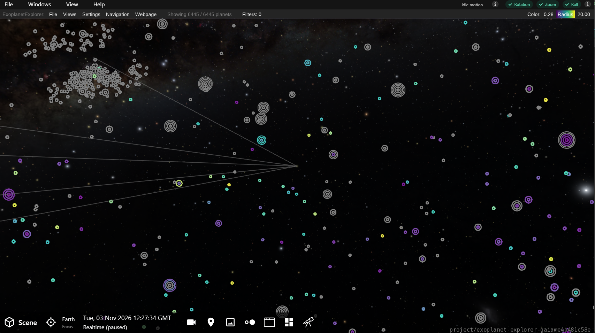
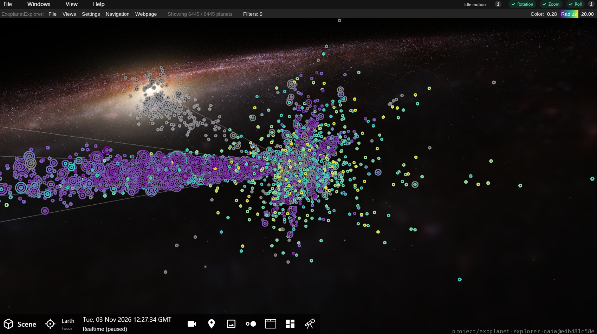
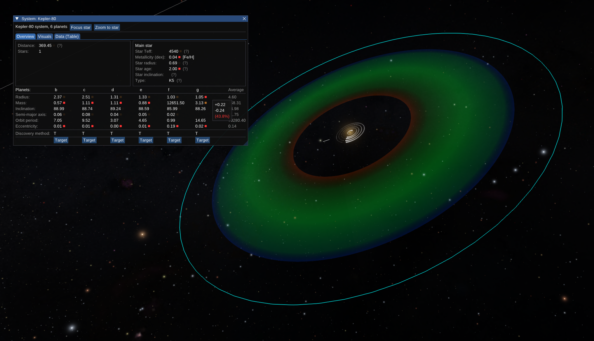
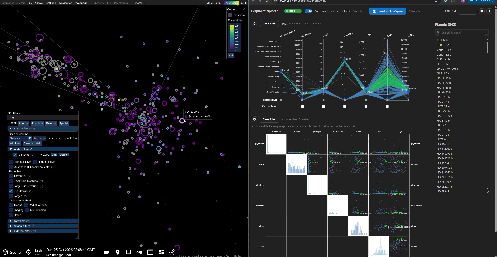

# Views Summary

The OpenSpace ExoplanetExplorer provides three main views for exploring exoplanet data: the *Spatial Overview*, the *System View*, and the *Linked Visual Analysis View*. The Spatial Overview and System View presents a spatial context for the exoplanet data and are rendered within the [OpenSpace](https://openspaceproject.com/) software, whereas the Linked Visual Analysis View consists of an external web-based interface that connects to the  OpenSpace.

## Spatial Overview

The Spatial Overview provides an overview of all loaded exoplanet systems, displayed at their positions within the galaxy. This view helps users to quickly grasp the overall distribution and spatial context of the exoplanet data, and includes features such as [filtering](../features/filtering), [colormapping](../features/colormapping-ang-glyphs) and [spatial selection](../features/spatial-selection).

## System View

The System View presents a 3D representation of an individual exoplanet systems, based on the parameters in the loaded dataset.

This view is reached by interacting with a specific exoplanet system in the Spatial Overview, adding the system, and navigating to it. More details on this navigation can be found in the [Interaction and Navigation](./interaction-and-navigation) section.

## Linked Visual Analysis View

The Linked Visual Analysis view is a webpage that allows users to interactively explore the data across multiple coordinated visual analysis views, while being linked to the spatial view rendered in OpenSpace. More details on how to use this view can be found in the [Linked Visual Analysis View](../features/visual-analysis-wepage) section.

