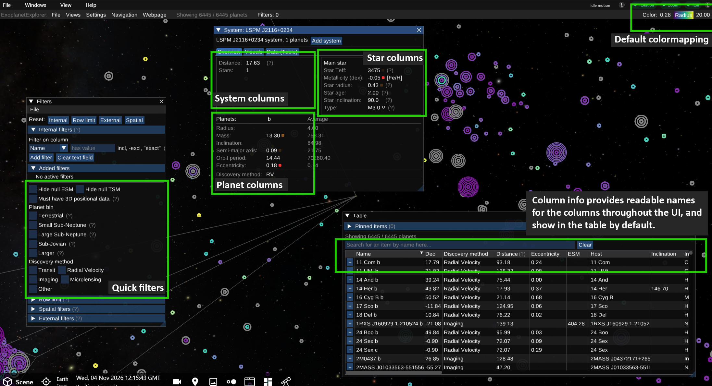

# Configuration

Each dataset has a corresponding JSON configuration file. The file points to the dataset and tells the ExoplanetExplorer how to interpret and present its columns. Keep the configuration and dataset in sync: every column name in the configuration must exist in that dataset.

At the bottom of this page is a complete [example configuration for the ExoplanetExplorer](#example-configuration).

## How to Change the Configuration

The default configuration file used for the ExoplanetExplorer is:
```
OpenSpace/modules/exoplanetexplorer/scripts/settings_exoplanets.json
```
This one is set up to provide an example mapping that is suitable for the data from the Exoplanet Archive. To change the configuration for a dataset, either edit the existing file, or create a new one.

Which configuration file is used is determined by the `exoplanet_explorer` profile. If you create a new file, update the profile to reference it, or duplicate the profile and point the copy to the new file.

:::important
The configuration file must always match the dataset it is intended for. Any mismatch between column names in the configuration and the dataset might result in errors or incorrect behavior in the ExoplanetExplorer.
:::

## Dataset and Column Mapping

Each dataset needs a configuration that maps its objects' names and positions to columns in the data. The minimal example below shows the required dataset path and mappings.

```json
{
  "datafile": "${MODULE_EXOPLANETEXPLORER}/data/aggregated_data.csv",
  "data_mapping": {
      "position_ra": "ra",
      "position_dec": "dec",
      "position_distance": "sy_dist",
      "name": "pl_name"
  }
}
```

The `datafile` value identifies the dataset to load. In the example below, `${MODULE_EXOPLANETEXPLORER}` is a module path variable, and the CSV is stored in that module's `data` directory.

The `data_mapping` section connects fields that have a specific role in the explorer to column names in the dataset. The left side is the field the explorer expects; the right side is the matching column in the CSV. For example, some of the key parameters are
the columns identifying the object, and that specify its position, in this case the right ascension, declination, and distance, and the planet name.

### Exoplanet-Specific Mappings

A number of the parameters in the data mapping are designed to specifically enable features relevant for exoplanets. This includes identifying the host star for each planet, which is crucial for grouping planets within their respective systems.

```json
"data_mapping": {
    ...
    "host_name": "hostname",
    "ring_size": "pl_orbsmax",
    "metallicity_ratio": "st_metratio",
    "discovery_method": "discoverymethod",
    "inclination": "pl_orbincl",
    "stellar_inclination": "st_incl"
}

```

- The `host_name` mapping specifies which column contains the name of the host star for each planet. This allows the explorer to group planets correctly within their respective systems.

- `ring_size` specifies the column containing the size of the planet's ring system, if applicable. This is used to order the concentric rings of the glyphs in the Spatial Overview.

- `metallicity_ratio` specifies the column containing the host star's metallicity ratio, which has a special display in the window for a given system.

- `discovery_method` specifies the column containing the method by which the planet was discovered and is used to display this information in the system view.

- `inclination` specifies the column containing the planet's orbital inclination and is used to display the tilt of the planet's orbit in the inclination glyph mode and System View.

- `stellar_inclination` specifies the column containing the host star's inclination and is used to display the tilt of the star in the inclination glyph mode and System View.


### Adding a Link to the Reference Paper

To add a link to the reference paper for each planet or object, use the `reference_name` and `reference_link` mappings. The `reference_name` should point to the column containing the paper's title or identifier, while `reference_link` should point to the column with the URL to the paper. This allows the explorer to display clickable references for each planet.

```json
"data_mapping": {
    ...
    "reference_name": "pl_refname_name",
    "reference_link": "pl_refname_url"
}
```

## Display and Filters

The remaining sections in the configuration control which information appears in the user interface, such as which columns are shown in the system view window, which quick filters are available, and which color mapping is used on startup. The image below shows where these options appear in the interface.



### `system_view`
Specifies which columns are displayed for systems, stars, and planets in the details view.

    ```json
    "system_view": {
        "planet_columns": ["pl_rade", "pl_bmasse"],
        "star_columns": ["st_teff", "st_mass"],
        "system_columns": ["sy_dist"]
    }
    ```

### `default_colormapping`
Specifies the column used for coloring when the dataset loads, along with the minimum and maximum values for its scale.

    ```json
    "default_colormapping": {
        "column": "pl_rade",
        "min": 0.276,
        "max": 20
    }
    ```

### `column_info`
Provides display metadata for columns, such as a readable label, description, numeric format, or text treatment.

    ```json
    "column_info": {
        "pl_rade": {
            "name": "Radius",
            "desc": "Planet radius in Earth radii"
        }
    }
    ```

### `quick_filters`
Defines named preset filters in groups. Each condition specifies a column and query; `type` determines how presets are combined, and `per_line` controls how many appear on each line.

    ```json
    "quick_filters": [
        {
            "group_title": "Planet bin",
            "type": "OR",
            "per_line": 1,
            "filters": [
                {
                    "column": "pl_rade",
                    "query": "<= 1.5"
                }
            ]
        }
    ]
    ```

## Example Configuration

Below is a complete example configuration for the ExoplanetExplorer, including data mappings, system view parameters, default color mapping, column information, and quick filters.

```json
{
    "datafile": "${MODULE_EXOPLANETEXPLORER}/data/aggregated_data.csv",
    "data_mapping": {
        "position_ra": "ra",
        "position_dec": "dec",
        "position_distance": "sy_dist",
        "name": "pl_name",
        "host_name": "hostname",
        "ring_size": "pl_orbsmax",
        "reference_name": "pl_refname_name",
        "reference_link": "pl_refname_url",
        "metallicity_ratio": "st_metratio",
        "discovery_method": "discoverymethod",
        "inclination": "pl_orbincl",
        "stellar_inclination": "st_incl"
    },
    "system_view": {
        "system_columns": ["sy_snum"],
        "star_columns": [
            "st_teff",
            "st_met",
            "st_metratio",
            "st_rad",
            "st_age",
            "st_incl",
            "st_spectype"
        ],
        "planet_columns": [
            "pl_rade",
            "pl_bmasse",
            "pl_orbincl",
            "pl_orbsmax",
            "pl_orbper",
            "pl_orbeccen"
        ]
    },
    "default_colormapping": {
        "column": "pl_rade",
        "min": 0.276,
        "max": 20
    },
    "column_info": {
        "pl_name": {
            "name": "Name",
            "isText": true
        },
        "hostname": {
            "name": "Host",
            "isText": true
        },
        "disc_year": {
            "name": "Year",
            "format": "%.0f",
            "desc": "Discovery year"
        },
        "sy_pnum": {
            "name": "Planets",
            "format": "%.0f"
        },
        "sy_snum": {
            "name": "Stars",
            "format": "%.0f"
        },
        "ESM": {
            "name": "ESM",
            "format": "%.2f"
        },
        "TSM": {
            "name": "TSM",
            "format": "%.2f"
        },
        "pl_rade": {
            "name": "Radius",
            "desc": "Planet radius in Earth radii"
        },
        "pl_Teq": {
            "name": "Teq",
            "format": "%.0f",
            "desc": "Planet equilibrium temperature (K)"
        },
        "pl_bmasse": {
            "name": "Mass",
            "desc": "in Earth masses"
        },
        "pl_surface_gravity": {
            "name": "Surface gravity",
            "desc": "(m/s^2)"
        },
        "pl_orbsmax": {
            "name": "Semi-major axis",
            "desc": "(AU)"
        },
        "pl_orbeccen": {
            "name": "Eccentricity"
        },
        "pl_orbper": {
            "name": "Orbit period"
        },
        "pl_orbincl": {
            "name": "Inclination"
        },
        "pl_refname_name": {
            "name": "Reference"
        },
        "st_teff": {
            "name": "Star Teff",
            "format": "%.0f",
            "desc": "Star effective temperature (K)"
        },
        "st_rad": {
            "name": "Star radius",
            "desc": "(Solar)"
        },
        "st_spectype": {
            "name": "Type",
            "desc": "Stellar spectral type",
            "isText": true
        },
        "st_incl": {
            "name": "Star inclination",
            "format": "%.1f",
            "desc": "Stellar inclination (deg)"
        },
        "st_age": {
            "name": "Star age",
            "desc": "(Gyr)"
        },
        "sy_jmag": {
            "name": "MagJ"
        },
        "sy_kmag": {
            "name": "MagK"
        },
        "sy_dist": {
            "name": "Distance",
            "desc": "(pc)"
        },
        "ra": {
            "name": "Ra"
        },
        "dec": {
            "name": "Dec"
        },
        "st_met": {
            "name": "Metallicity (dex)"
        },
        "st_metratio": {
            "name": "Metallicity ratio",
            "isText": true
        },
        "discoverymethod": {
            "name": "Discovery method",
            "isText": true
        },
        "disc_telescope": {
            "name": "Telescope",
            "isText": true
        },
        "disc_instrument": {
            "name": "Instrument",
            "isText": true
        }
    },
    "quick_filters" : [
        {
            "group_title": "",
            "type": "AND",
            "per_line": 2,
            "filters": [
                {
                    "name": "Hide null ESM",
                    "filter": {
                        "column": "ESM",
                        "query": ""
                    }
                },
                {
                    "name": "Hide null TSM",
                    "filter": {
                        "column": "TSM",
                        "query": ""
                    }
                },
                {
                    "name": "Must have 3D positional data",
                    "filter": [
                        {
                            "column": "ra",
                            "query": ""
                        },
                        {
                            "column": "dec",
                            "query": ""
                        },
                        {
                            "column": "sy_dist",
                            "query": ""
                        }
                    ],
                    "desc": "Only include data points that will show up in OpenSpace's 3D rendered view"
                }
            ]
        },
        {
            "group_title": "Planet bin",
            "type": "OR",
            "per_line": 1,
            "filters": [
                {
                    "name": "Terrestrial",
                    "filter": {
                        "column": "pl_rade",
                        "query": "<= 1.5"
                    },
                    "desc": "Rp <= 1.5  (Earth radii)"
                },
                {
                    "name": "Small Sub-Neptune",
                    "filter": [
                        {
                            "column": "pl_rade",
                            "query": "> 1.5"
                        },
                        {
                            "column": "pl_rade",
                            "query": "<= 2.75"
                        }
                    ],
                    "desc": "1.5 < Rp <= 2.75 (Earth radii)"
                },
                {
                    "name": "Large Sub-Neptune",
                    "filter": [
                        {
                            "column": "pl_rade",
                            "query": "> 2.75"
                        },
                        {
                            "column": "pl_rade",
                            "query": "<= 4.0"
                        }
                    ],
                    "desc": "2.75 < Rp <= 4.0 (Earth radii)"
                },
                {
                    "name": "Sub-Jovian",
                    "filter": [
                        {
                            "column": "pl_rade",
                            "query": "> 4.0"
                        },
                        {
                            "column": "pl_rade",
                            "query": "<= 10.0"
                        }
                    ],
                    "desc": "4.0 < Rp <= 10.0 (Earth radii)"
                },
                {
                    "name": "Larger",
                    "filter": [
                        {
                            "column": "pl_rade",
                            "query": "> 10.0"
                        }
                    ],
                    "desc": "Rp > 10.0 (Earth radii)"
                }
            ]
        },
        {
            "group_title": "Discovery method",
            "type": "OR",
            "per_line": 2,
            "filters": [
                {
                    "name": "Transit",
                    "filter": [
                        {
                            "column": "discoverymethod",
                            "query": "transit"
                        }
                    ]
                },
                {
                    "name": "Radial Velocity",
                    "filter": [
                        {
                            "column": "discoverymethod",
                            "query": "radial velocity"
                        }
                    ]
                },
                {
                    "name": "Imaging",
                    "filter": [
                        {
                            "column": "discoverymethod",
                            "query": "imaging"
                        }
                    ]
                },
                {
                    "name": "Microlensing",
                    "filter": [
                        {
                            "column": "discoverymethod",
                            "query": "microlensing"
                        }
                    ]
                },
                {
                    "name": "Other",
                    "filter": [
                        {
                            "column": "discoverymethod",
                            "query": "-transit, -radial, -imaging, -microlensing"
                        }
                    ]
                }
            ]
        }
    ]
}
```

