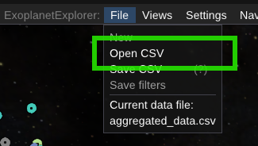
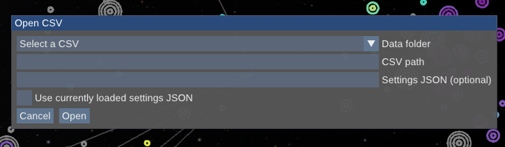
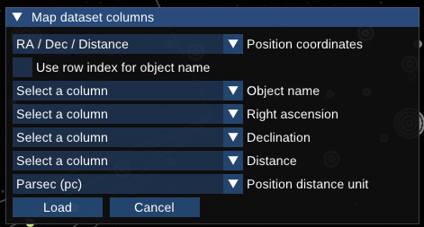

# Loading Custom Datasets

While the ExoplanetExplorer is made to work with its default dataset, it is also possible to load and work with custom point-datasets. You can do this in two ways:

1. Providing a custom CSV file during runtime
2. By specifying a JSON configuration file that defines the dataset and its mappings at startup

## Where to Put the Dataset

For the [linked webpage](../features/visual-analysis-wepage.mdx) to work correctly with your custom dataset, the data file currently needs to be placed in the same directory as the explorer's default data files, e.g., `OpenSpace/modules/exoplanetexplorer/data/`.

## Load a CSV at Runtime

Loading a custom CSV at runtime is done in the ExoplanetExplorer's `File` menu, where you can select and load your CSV file directly into the explorer.

This opens a modal where you can either select a CSV file in your `OpenSpace/modules/exoplanetexplorer/data/` directory or specify the path to another file on your system.

The modal also includes the option to load a [JSON configuration file](./configuration) that defines how the CSV columns should be mapped to the required fields in the explorer. If you do not specify a configuration file, in the next step you will be prompted to map the columns in your CSV to the required fields, such as positions and a name or other identifying column:

If your dataset does not include an object name or other identifying column, you can choose to "Use row index for object name". The index of each row in the CSV will then be used to identify the objects uniquely within the explorer, and shown on hover and in menus.

## Use a Custom Dataset at Startup

To use a custom dataset at startup, you need to provide a JSON configuration file that specifies the dataset and its mappings. This includes specifying the CSV file path, mapping columns for positions, names, and other relevant properties, and setting up the system view, default color mapping, and any quick filters you want to use.

See the [configuration guide](./configuration) for detailed instructions on setting up a configuration for a custom dataset at startup.

After creating your dataset and its corresponding JSON configuration file, you need to edit the part to the loaded configuration file in the `exoplanet_explorer` profile. The property `Modules.ExoplanetExplorer.DataConfigFile` should be set to the path of your JSON configuration file. You can do this either by editing the exisitng `exoplanet_explorer` profile file directly or by duplicating it and then setting the `Modules.ExoplanetExplorer.DataConfigFile` property in the duplicated profile to point to your custom JSON configuration file.

## Dataset Requirements

For full functionality, structure your dataset like the default `aggregated_data.csv`, based on the [NASA Exoplanet Archive](https://exoplanetarchive.ipac.caltech.edu/) data model, and map the columns needed for visualization and analysis.

At minimum, provide a 3D position (X, Y, and Z, or Right Ascension, Declination, and Distance) . This will correctly map the spatial location of each object and let you use most of the visualization and analysis features available in the tool.

An object name or identifier is recommended; if omitted, you can use row indices when loading a CSV at runtime.

## Uncertainties

The ExoplanetExplorer can also handle uncertainties in the dataset and uses the same naming convention as the error columns for the NASA Exoplanet Archive: for a measurement column named `measurement`, the corresponding uncertainty columns should be named `measurement_err1` and `measurement_err2`.

If uncertainty columns with this naming convention are included in the dataset, they will automatically be recognized and used by the ExoplanetExplorer. This allows the ExoplanetExplorer to correctly interpret and visualize the uncertainties in the data.